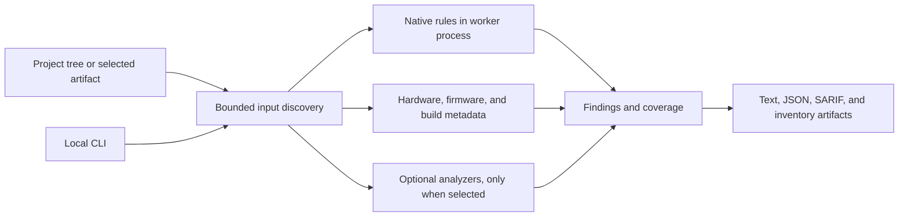

# FUSE

## Firmware & Unified Security Engine

**A [VIGIL](https://github.com/VIGIL-IoT) Project**

FUSE is a CLI-first analysis tool for embedded and IoT project repositories. It checks selected source and configuration files, inventories hardware and firmware candidates, reads selected build metadata, and can run optional dependency or firmware analyzers. Reports include evidence and explicit coverage so a static signal is not mistaken for a confirmed vulnerability.

[](https://github.com/VIGIL-IoT/VIGIL-FUSE/actions/workflows/ci.yml)
[](https://github.com/VIGIL-IoT/VIGIL-FUSE/releases)
[](pyproject.toml)
[](LICENSE)

**Alpha · 0.2.0**

## Start here

Requires Python 3.11 or newer. The native scanner has no runtime dependencies.

```sh
python -m pip install -e .
vigil-fuse doctor
vigil-fuse scan path/to/embedded-project --plan
vigil-fuse scan path/to/embedded-project --output-dir .fuse-results
```

A normal scan writes `findings.json`, `findings.txt`, and `findings.sarif` to `.fuse-results/`. Start with `--plan` to review selected inputs, supported stages, limits, and available tools before scanning.

## How a scan works



Native rules analyze selected text without importing or executing project code. FUSE does not flash devices, contact device services, or prove that a static signal is reachable in a deployed product. Optional external analyzers are separate tools and are not sandboxed by FUSE.

## Understand a finding

Severity describes potential impact. Confidence describes the strength of the evidence. Applicability and validation are separate fields. FUSE does not combine these into a single risk score.


The figure starts from the illustrative `FUSE001` record in the [finding format](docs/finding-schema.md). It is a teaching example, not a scan result or a physical FUSE device. [Open the interactive version](site/diagrams/fuse-finding-model.html).

## Current scope

- Seven conservative native rules for credential-like literals, private-key markers, TLS verification bypasses, plaintext HTTP and MQTT endpoints, and two ESP-IDF image-validation settings.
- Hardware and firmware candidate inventories. These report recognized files and metadata, not hardware or firmware security assessments.
- Selected ESP-IDF, Zephyr, PlatformIO, compilation database, and GitHub Actions metadata checks.
- Optional Syft and OSV-Scanner dependency analysis, Binwalk firmware signature identification, and Gitleaks history checks.
- Text, schema-versioned JSON, SARIF, CycloneDX inventory, scan coverage, evidence, and remediation guidance.

See [supported inputs and limits](src/vigil_fuse/support-matrix.json), [firmware analysis](docs/firmware-analysis.md), [hardware analysis](docs/hardware-analysis.md), and [known limitations](docs/limitations.md) for exact boundaries. FUSE does not provide compiler-semantic C/C++ analysis, general firmware extraction, device testing, or hardware-in-the-loop validation.

## Relationship to the VIGIL-IoT suite

FUSE is a VIGIL Project. Within the wider [VIGIL-IoT suite](https://github.com/VIGIL-IoT), it inspects candidate weaknesses while SPECTRA-32 can reproduce selected cases in a controlled lab, evaluate mitigations, and measure overhead. Findings remain candidates until the relevant behavior is validated.

## Documentation

- [Architecture and data flow](docs/architecture.md)
- [Finding fields and JSON schema](docs/finding-schema.md)
- [Rules and fixture requirements](docs/rule-development.md)
- [Configuration and integrations](docs/integrations.md)
- [Threat model](docs/threat-model.md) · [Limitations](docs/limitations.md)
- [Methodology](docs/methodology.md) · [Traceability](docs/traceability.md)
- [Benchmark method and evidence](docs/benchmarks.md) · [Synthetic scan baseline](reports/benchmark/scan-performance.json) · [Pinned repository performance report](reports/benchmark/repository-scan-performance.json)
- [Repository scan reports](reports/repository-scans/README.md) · [Evaluation notes](docs/experiments/pilot-scan-2026-10.md)
- [Development roadmap](docs/roadmap.md) · [Release process](docs/release-process.md)
- [Project site](site/) · [Website maintenance notes](docs/website.md)

## Develop

```sh
python -m pip install -e ".[dev]"
python -m pytest -q
python -m ruff check src tests scripts
python -m mypy
python scripts/validate_docs.py
```

See [CONTRIBUTING.md](CONTRIBUTING.md) for repository setup and [rule development](docs/rule-development.md) for the vulnerable fixture, secure fixture, and expected-result workflow.

## License

FUSE uses the custom [VIGIL-FUSE Restricted Use License](LICENSE). Personal and commercial use is permitted. Redistribution and publishing modified copies require written permission. It is source-available software, not OSI-approved open-source software.

---

**FUSE · Firmware & Unified Security Engine · A [VIGIL](https://github.com/VIGIL-IoT) Project**
