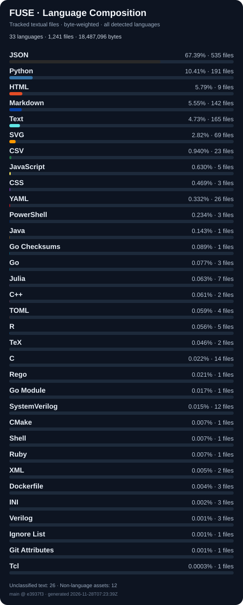

# FUSE

<p align="center">
  
</p>

[](https://github.com/VIGIL-IoT/VIGIL-FUSE/actions/workflows/ci.yml)
[](https://github.com/VIGIL-IoT/VIGIL-FUSE/releases)
[](https://vigil-iot.github.io/VIGIL-FUSE/)
[](https://pypi.org/project/vigil-fuse/)
[](pyproject.toml)
[](LICENSE)

## Firmware & Unified Security Engine

FUSE is a local analysis tool for embedded and IoT repositories. It collects bounded source, build, firmware, dependency, hardware, and policy evidence. Native findings remain review candidates: static signals do not prove exploitability, shipment, reachability, or physical exposure.

**Canonical repository:** [VIGIL-IoT/VIGIL-FUSE](https://github.com/VIGIL-IoT/VIGIL-FUSE)

**Source version:** `0.4.1.dev0`

**Latest PyPI package:** `0.4.0`. This migration has not published a new package.

The standalone [ShivuXD/FUSE](https://github.com/ShivuXD/FUSE) repository was used for competition and integration work. The canonical repository now carries its adapted production and research features. See the [final migration report](docs/standalone-fuse-final-migration.md) and [machine-readable parity ledger](migration/full-parity-ledger.json) for branch accounting, exclusions, and verification evidence.

## Install and run

FUSE requires Python 3.11 or newer. The core Python package has no runtime dependencies. Install from this checkout to use the current source:

```powershell
python -m pip install .
vigil-fuse --version
vigil-fuse doctor
vigil-fuse scan path/to/embedded-project --plan
vigil-fuse scan path/to/embedded-project --output-dir .fuse-results
```

For development, install the optional CLI prompt and development tools:

```powershell
python -m pip install -e ".[dev,cliui]"
```

The published `0.4.0` package predates the migrated features. New releases are not part of this migration. See [installation](docs/installation.md) and [local release validation](docs/releasing.md).

## CLI

`vigil-fuse` with no arguments opens the interactive session without scanning. `/help` lists commands. `/target [directory]` shows or changes the current target, `/profile [name]` selects a profile, `/scan` runs a scan, `/plan` previews it, `/findings` reviews the latest result, and `/baseline` opens baseline commands. `/doctor`, `/version`, `/clear`, and `/exit` are also available. The optional `cliui` extra adds command completion and line editing.

Non-interactive commands include `scan`, `doctor`, `setup`, `baseline`, `inspect`, `reason`, `reasoning-context`, `applicability analyze`, and the focused `digital-twin`, `flight-bus`, `seu`, and `physical-reachability` commands. Use `vigil-fuse --help` and `vigil-fuse scan --help` for the exact options.

Reports include JSON, text, and SARIF, with coverage, analyzer statuses, inventories, and artifact hashes. Each report identifies FUSE and the VIGIL project. Report bundles also include `FUSE_SCAN_PROVENANCE.json` with report-file hashes and `CITATION.cff` with the runtime version. The bounded project identity summary in scan reports and `scan --plan` is advisory; its evidence scores are not probabilities and do not enable analyzers. By default, report files go to a sibling `.fuse-results/<target-name>/` directory so a scan does not write into the target. `--output-dir` selects another location. Interactive scans can also offer a PDF report. XeLaTeX uses Times New Roman; a pdfLaTeX-only fallback uses a Times-compatible font. The JSON report preserves separate severity, confidence, applicability, validation, and coverage fields. See the [finding format](docs/finding-schema.md) and [usage guide](docs/usage.md).

The optional [desktop GUI](docs/desktop-gui.md) provides local plans, findings, coverage, baselines, and report export. Launch it with `vigil-fuse-gui` from a Tk-enabled Python environment.

## Analysis layers

- **Deterministic source checks:** seven conservative rules for credential-like literals, private-key markers, TLS verification bypasses, plaintext HTTP and MQTT endpoints, and ESP-IDF image validation settings.
- **Build context:** bounded ESP-IDF, Zephyr, and PlatformIO metadata, hardenconfig report intake, dependency lock inventory, and passive `compile_commands.json` indexing. FUSE does not run project build commands or compiler commands.
- **C/C++ semantics:** an experimental optional Clang LibTooling adapter returns bounded AST observations. Python validates the evidence. Observations do not create findings by themselves. See [compiler-semantic evidence](docs/cpp-semantic-analysis.md).
- **Firmware and supply chain:** candidate inventory, optional Binwalk signature identification without extraction, optional Ghidra static metadata, Syft SBOM generation, OSV advisory matching, Gitleaks history scanning, VEX review context, and provenance subject digest comparison.
- **Hardware and RTL:** hardware-file inventory, explicit BOM import with CycloneDX HBOM output, selected KiCad XML netlist candidates, and bounded Verilog/SystemVerilog structural checks. A net connection does not establish physical access. RTL presence does not prove synthesis, implementation, or activity.
- **Embedded and cyber-physical evidence:** Device Tree and CMSIS-SVD parsing, explicit pin reachability candidates, partial cFE bus observations, resilience indicators, digital-twin descriptions, and constrained synthetic Renode exports. These experimental layers preserve unknowns and do not validate devices.
- **Policy and reasoning:** optional local OPA/Rego evaluation returns separate `PASS`, `FAIL`, or `UNKNOWN` policy state. Optional loopback-only Ollama reasoning explains completed evidence. FUSE remains the finding authority; model output cannot add or change findings.
- **Go and Kubernetes:** an experimental identity-probe and execution foundation. Go schedules work; Python remains the security authority. Job completion is not a security verdict.
- **Research:** offline R and Julia workflows are separate from normal scans. The documented Rust decision is `NO_RUST_NEEDED_YET`; Zig remains `NO_ZIG_NEEDED`. Neither is a production runtime dependency.
- **Deep evidence development:** the explicit `python -m vigil_fuse.deep_evidence` CLI connects versioned graphs, semantic paths, dependency reachability, binary/rootfs metadata, runtime observations, cross-layer candidates, attack paths and policy evidence. Existing scan findings remain separate. See the [deep-engine guide](docs/deep-engine.md) and [independent benchmark program](docs/independent-benchmark.md), including unavailable live-tool coverage and unmeasured accuracy.

The machine-readable [support matrix](src/vigil_fuse/support-matrix.json) labels each capability as detected, basic, supported, partial, experimental, planned, or unsupported. Optional tool absence is reported as stage coverage, not a core scanner failure. See [limitations](docs/limitations.md) and the layer-specific guides linked from the [documentation index](docs/usage.md).

## Historical NVIDIA regression

The migration record preserves a deterministic scan of `NVIDIA/edk2-nvidia` at commit `cb638768ec174bb2041f87569409c53e4af4292e` (`uefi-202609.1`): 1,223 files selected and scanned, none skipped, discovery complete, and one `FUSE001` review candidate with medium severity, high confidence, unknown applicability, and no validation. It is not a confirmed NVIDIA vulnerability, and the rules were not tuned to reproduce it. See the [full migration record](docs/standalone-fuse-final-migration.md).

## Development and boundaries

```powershell
python -m pip install -e ".[dev,cliui]"
python -m pytest -q
python -m ruff check src tests scripts
python -m mypy
python scripts/validate_docs.py
```

Optional analyzers run only when requested. Host mode is not an OS sandbox; explicit Docker mode is available for supported analyzers. Normal scans do not require or download Ollama, model weights, CUDA, Ghidra, Java, LLVM, OPA, Go, Kubernetes, R, Julia, Rust, Zig, or Docker. Read the [threat model](docs/threat-model.md), [architecture](docs/architecture.md), [C/C++ trust boundary](docs/cpp-semantic-analysis.md), and [local reasoning contract](docs/local-reasoning.md) before enabling optional stages.

The Vercel homepage is reachable, but its deployed content has not been reconciled with the migrated feature set. The PyPI project page is available and still lists `0.4.0`. This migration did not deploy a site build or publish a package; neither action is a completion gate.

FUSE is distributed under the custom [VIGIL-FUSE Restricted Use License, version 1.2](LICENSE), which is not an OSI-approved open-source license. See the license for current permissions and [CITATION.cff](CITATION.cff) for contributor attribution.

## Language composition

<p align="center">
  
</p>
<p align="center"><sub>Compact byte-weighted line graph. Each point label shows its language and exact share. <a href="docs/language-composition.md">How the inventory is measured</a>.</sub></p>
