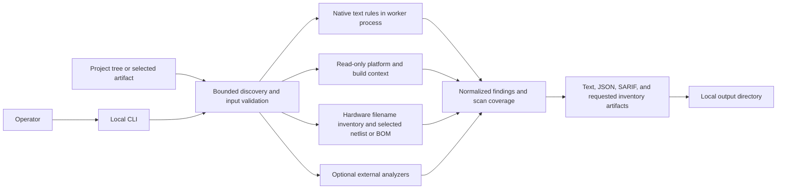
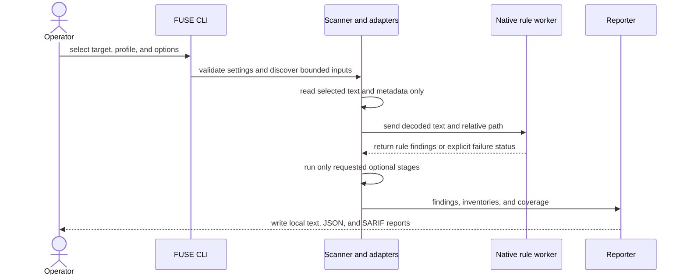
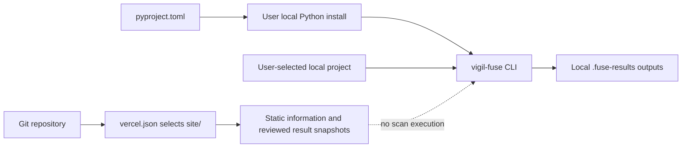
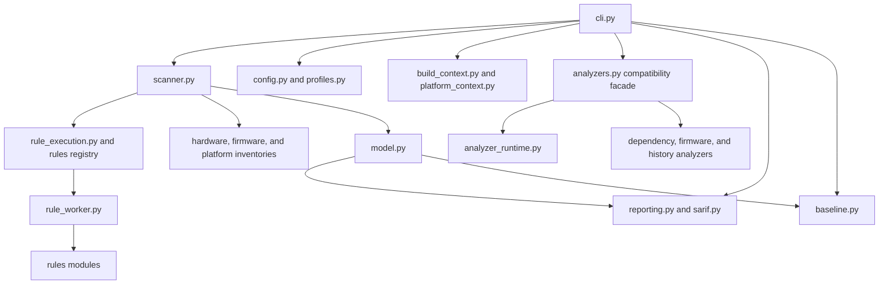
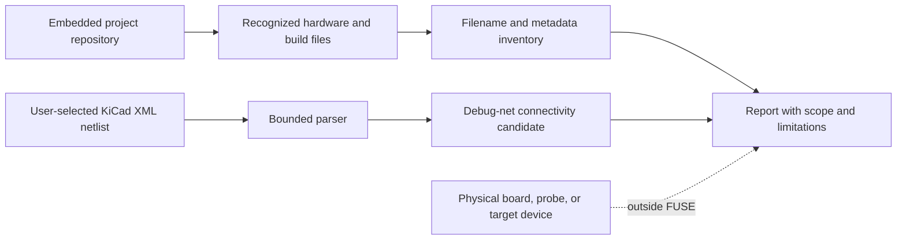

# FUSE architecture

FUSE is a [VIGIL](https://github.com/VIGIL-IoT) Project in the [VIGIL-IoT suite](https://github.com/VIGIL-IoT). The initial implementation is a small Python package with a CLI boundary and no runtime dependencies.

## Current system architecture

The diagrams below describe implemented behavior. A stage marked optional runs only when requested and when its external executable or input is available.





The deployment model is a local command-line process. There is no FUSE server or required cloud service. Optional analyzers are separate executables invoked only when selected. Physical devices, firmware flashing, and network probing are outside the analysis path.

The repository also contains a separately configured static site. This diagram shows repository configuration, not proof that a deployment is currently active:



```text
CLI
 ├─ validates target, profile, config, and output options
 ├─ scanner inventories hardware filenames, firmware-like paths, and selected text/code files
 ├─ optional platform adapter reads selected build context and imports Zephyr hardenconfig JSON
 ├─ build-context adapter resolves bounded PlatformIO includes and indexes compile database metadata
 ├─ GitHub Actions adapter checks explicit broad permissions and non-SHA action references
 ├─ optional KiCad netlist adapter records debug-interface connectivity candidates
 ├─ optional hardware BOM adapter imports CSV/TSV components and exports CycloneDX HBOM
 ├─ scanner hashes and decodes bounded source inputs with disclosed legacy-encoding fallback
 ├─ isolated rule worker runs each native check under a per-input timeout
 ├─ optional Syft / OSV-Scanner / Binwalk / Gitleaks adapters run as bounded subprocesses
 ├─ product-context adapter correlates exact CycloneDX VEX identities and SLSA subject digests
 ├─ common Finding model carries severity, confidence, evidence, component identity, and review context
 ├─ reporters emit text, schema 1.10 JSON, SARIF, inventories, coverage, and artifact hashes
 └─ baseline review consumes canonical JSON reports to compare changes and apply reasoned suppressions
```

## Module responsibilities

- `cli.py`: command-line arguments, terminal illustration, `doctor`, non-executing plan, baseline review commands, output selection, and CI exit thresholds.
- `baseline.py`: bounded JSON report loading, complete-scan baseline creation, line-insensitive and conservative move-aware diff identities, stable shareable target labels, project-bound suppressions, and incomplete-scan safeguards.
- `config.py` and `profiles.py`: validated TOML configuration and file-discovery profiles.
- `input_types.py`: recognized existing CycloneDX/SPDX documents and routes them to the inventory/advisory stage.
- `scanner.py`: deterministic text discovery, path filtering, generated-directory exclusions, unsupported file-type counts, input hashes, symlink and special-file policy, size limits, and text decoding. Its bounded path preview powers `scan --plan` without opening project source files.
- `firmware_inventory.py`: bounded filename and size inventory across source and common build-output directories. It never reads candidate image bytes.
- `github_actions.py`: bounded, line-oriented checks for workflow-level `write-all` permissions, inventory of non-SHA action references, and findings on obvious floating branch refs. Findings remain repository workflow candidates.
- `hardware_netlist.py`: UTF-8 and DTD checks, streaming XML depth and element preflight, then bounded parsing of selected or uniquely detected KiCad netlists for named debug nets attached to connector candidates. It does not infer physical exposure.
- `hardware.py`: filename-only recognition for hardware design, CAD, BOM, HDL, and fabrication artifacts.
- `build_context.py`: bounded PlatformIO `extra_configs` include resolution, environment and source-filter metadata, and compilation-database indexing. It records metadata only and never invokes PlatformIO, a compiler, or a build command.
- `hardware_bom.py`: explicit CSV/TSV component import and CycloneDX 1.6 hardware BOM generation. Filename discovery remains separate from content parsing.
- `product_context.py`: package URL construction, exact-match CycloneDX VEX annotations, and in-toto SLSA subject digest comparison for firmware. It does not authenticate signatures or trust builders.
- `text_safety.py`: bounds imported metadata and escapes terminal control and bidirectional characters in human-readable CLI output.
- `platform_context.py` and `esp_idf_lock.py`: bounded, read-only ESP-IDF and Zephyr build metadata inspection, including optional parsing of ESP-IDF `dependencies.lock`. They never invoke the build system or component manager.
- `zephyr_hardening.py`: validates a bounded report from Zephyr's upstream hardening tool and maps its failed options into common findings without copying Zephyr's recommendation database.
- `support.py` and `support-matrix.json`: shared, machine-readable capability labels used by reports, `doctor`, and scan planning.
- `rule_execution.py` and `rule_worker.py`: run native rules in a killable Python subprocess, enforce per-rule and scan-wide deadlines, and return explicit per-rule coverage statuses.
- `model.py`: shared source, finding, component, build inventory, hardware inventory, product review, analyzer-status, and scan-result data structures.
- `rules/`: one module per rule plus the explicit rule registry. Rule scanners receive source text in the isolated worker and emit common findings. FUSE003 uses the standard-library Python AST for qualified Requests and HTTPX verification arguments, while retaining bounded lexical checks for other inputs.
- `reporting.py` and `sarif.py`: text, schema-versioned JSON with explicit input-inventory scope, component and VEX context, and SARIF serialization.
- `analyzer_runtime.py`: shared bounded subprocess, best-effort process-tree cleanup, common credential-name environment filtering with exact tool-specific opt-in forwarding, tool-version, artifact-path, and artifact-hash helpers for optional analyzers.
- `dependency_analyzers.py`: optional Syft inventory and OSV vulnerability matching.
- `firmware_analyzer.py`: optional Binwalk signature identification only, with no extraction.
- `history_analyzer.py`: optional redacted Gitleaks history scanning.
- `analyzers.py`: backward-compatible adapter facade used by the CLI. Optional analyzers remain isolated from native rules and write artifact hashes into the report.
- `schemas/`: machine-readable report schema shipped with the Python package.
- `tests/fixtures/rules/`: vulnerable and secure inputs for each enabled rule.



The native-rule worker receives decoded source text and relative paths over a private pipe. It does not import or execute project files. The subprocess exists to enforce timeouts; it does not reduce the worker's operating-system privileges or replace a sandbox for hostile analyzer inputs. Optional analyzers run in isolated process groups on POSIX. On Windows, FUSE uses the system `taskkill` utility to request termination of the analyzer and its child processes. This is best-effort cleanup, not a sandbox. See the [threat model](threat-model.md) for trust boundaries and residual risks.

## Rule contract

Each rule has a stable ID, title, severity, confidence, category, explanation, potential impact, remediation, optional references, and a scanner function. Rules should match explicit evidence and avoid extrapolating exploitability. A finding's evidence must be useful and must not disclose literal credentials or private-key material.

Every rule change should include a vulnerable fixture that produces the intended finding and a secure fixture that produces no finding for that rule. The automated tests load fixtures and exercise the rule directly. Scanner and reporter tests cover end-to-end path handling and output shape.

## Deliberate boundaries

Native rules analyze selected source/configuration text only. The separate hardware inventory recognizes known formats by filename, records paths and counts, and makes no judgment about hardware security. Firmware candidate inventory records only extension and size. The GitHub Actions analyzer covers two explicit static signals and is not a complete YAML or event-taint analysis. The KiCad netlist analyzer reports candidate connectivity only and does not establish physical access. Optional Syft inventories local directory/file inputs; OSV-Scanner matches generated or supplied CycloneDX/SPDX SBOMs or project manifests to known advisories; Binwalk identifies firmware signatures without extraction; Gitleaks inspects commits reachable from `HEAD` when explicitly enabled. The Gitleaks adapter does not retain raw secret values, and it marks shallow history as partial. FUSE does not contact device services, validate credentials, extract or execute firmware, or infer runtime reachability. OSV uses the network unless the user selects its local database or strict no-network mode. The executable adapters have explicit timeouts, streaming output limits, statuses, versions, and output hashes; firmware parsing is still performed by the selected external tool and should be isolated for hostile input.

Profiles control source discovery and choose the platform context adapter. The experimental `--build-dir` adapter reads only bounded, known files in a user-selected directory. ESP-IDF context records the selected `sdkconfig`, observed defaults-file order, target-specific variants, and file hashes. Conventional defaults remain candidates if the selected build does not identify them. FUSE never evaluates project CMake, runs a build, resolves Kconfig dependencies, or claims the selected output was deployed. ESP-IDF scans can also inventory bounded `dependencies.lock` metadata with the optional PyYAML extra; resolved components are not claimed to be built into or shipped in an image, and manifest freshness is unverified. Zephyr context records its generated configuration, board, and version when available. With `--zephyr-hardening-report`, it can import a bounded JSON report emitted by Zephyr's own hardening tool without invoking `west` or a build. Imported deviations retain Zephyr's profile and rationale, use unknown severity, and remain candidate configuration signals. PlatformIO environments and compilation databases add build-selection context but do not run commands or provide compiler-semantic analysis. Explicit hardware BOM import is separate from filename inventory and records source provenance in its CycloneDX artifact. Product VEX stays review metadata attached only to exact product, package, and advisory matches; it does not change the finding or its threshold result. SLSA intake compares a selected firmware digest with an attested subject but does not authenticate the statement or builder. The result records profile, selected/skipped files, active rules, project and product context, analyzer status, an input-manifest digest, and artifact paths/hashes. The canonical JSON report is schema-versioned; new adapters must report missing tools, partial coverage, and failures explicitly instead of returning an empty result as if analysis completed. SARIF exports normalized findings for code-scanning tools; CycloneDX remains the component-inventory format.

## Hardware-software boundary



FUSE examines files and metadata. It has no hardware connection and does not verify that a candidate net is routed, populated, accessible, or enabled on a physical device.

FUSE and SPECTRA-32 have complementary roles in the [VIGIL-IoT suite](https://github.com/VIGIL-IoT): FUSE inspects candidate weaknesses, while SPECTRA-32 can reproduce selected cases in a controlled lab and measure mitigation overhead.
