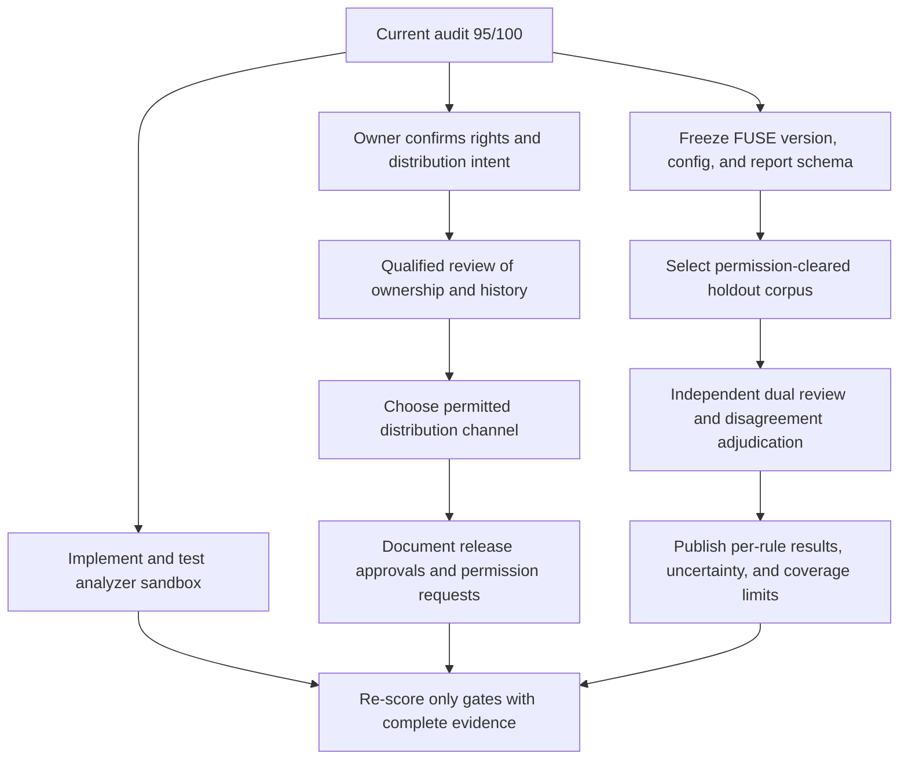

# FUSE maturity 100-point closure plan

**Research date:** 2026-11-02
**Current score:** 95/100
**Method:** Crawl4AI 0.9.5 browser retrieval of official NIST, Docker, Open Source Initiative, GitHub, Python Software Foundation, and Semgrep documentation.

**License status update:** At the repository owner's request, the root `LICENSE` file and project license metadata were removed on 2026-11-02. The current checkout has no declared project license. This does not change prior commits or releases, including commits that contained different license text. The score below gives one point for completed analyzer conformance evidence and one point for the documented no-public-code-contributions policy. Removing the license file itself earns no point.

## The remaining five points

The current audit assigns the remaining points to four evidence gaps. A point is earned only after its stated evidence exists and the audit is updated. Adding a feature without verification does not close a point.

| Area | Current | Gap | Closure evidence |
| --- | ---: | ---: | --- |
| Code quality | 15/15 | Closed on 2026-11-02. Four optional analyzers have a pinned conformance scope, positive and negative controls, missing-tool handling, input-immutability checks, and cross-platform CI evidence | See the completed code-quality gate and its linked GitHub Actions runs below |
| Security | 9/10 | Optional analyzer processes can access files and operating-system resources available to the FUSE user | Enforced sandbox policy, negative escape and network tests, resource-limit checks, supported-platform results, fail-closed behavior when isolation is required but unavailable, and updated threat model |
| Governance | 7/10 | Three rights, distribution, and release-policy decisions remain unresolved. Code contributions are paused and require written owner permission. | Owner decision plus qualified legal review; consistent rights and contribution policies; documented channel-specific permission and approval gates |
| Research rigor | 9/10 | Existing tests and NIST SARD results do not provide independent, representative field-accuracy adjudication | Frozen, permission-cleared holdout corpus; independent reviewers; disagreement adjudication; per-rule metrics with uncertainty and coverage limitations |

## License status and governance constraints

The repository currently declares no project license. Removing the root `LICENSE` file does not grant permission to use, redistribute, modify, or publish the project, and it does not erase license text or grants recorded in earlier commits and releases. The repository history includes more than one license state, so the rights holder should review that history with qualified counsel before deciding how to distribute future copies.

Future distribution needs an explicit rights decision. An OSI-approved open-source license would permit copying and redistribution under its terms. A source-available license could impose different terms but would not qualify as open source. No new license or rights grant is selected by this plan.

The owner should confirm the rights holders for the code and included assets, decide whether outside code contributions will be accepted, and document terms before reopening public code contributions. `CONTRIBUTING.md` currently pauses code submissions while those terms are unresolved. An issue report and a code contribution grant different rights.

The current PyPI Terms of Service include ownership, right-to-post, and license-grant terms. The PyPI Acceptable Use Policy also prohibits infringing intellectual-property rights. Review the current terms and rights history before any registry upload. These pages do not determine FUSE's ownership or distribution permissions. The older PyPI Terms of Use URL redirects to a page marked superseded; use the current Terms of Service for any future review.

## Closure gates by score

### Code quality, completed at 15/15

This gate is closed for the declared integration scope. The tests answer whether each adapter behaves predictably for the inputs and tool versions it claims to support. This is separate from the open security sandbox gate.

1. Syft 1.55.0, OSV-Scanner 2.7.0, and Gitleaks 8.30.0 use SHA-256-pinned releases. Their Linux, macOS, and Windows integration run [41377700744](https://github.com/VIGIL-IoT/VIGIL-FUSE/actions/runs/41377700744) passed. The dependency harness change also passed run [41377646976](https://github.com/VIGIL-IoT/VIGIL-FUSE/actions/runs/41377646976).
2. Binwalk 3.1.0 is built from a pinned upstream commit and checked against positive, clean, malformed, and hash-pinned firmware controls. The Ubuntu and Windows run [41377931313](https://github.com/VIGIL-IoT/VIGIL-FUSE/actions/runs/41377931313) passed.
3. Missing Syft, OSV-Scanner, Binwalk, and Gitleaks are reported as unavailable. Shared subprocess tests cover timeout, output caps, descendant cleanup, and explicit failure states. Gitleaks integration verifies that secret-shaped values are not retained.
4. The Syft/OSV, Gitleaks, and Binwalk end-to-end harnesses hash selected inputs before and after scanning and fail if an analyzer modifies them. Mutation-control tests cover the guards.
5. Latest FUSE CI [41378841057](https://github.com/VIGIL-IoT/VIGIL-FUSE/actions/runs/41378841057) and CodeQL [41378840999](https://github.com/VIGIL-IoT/VIGIL-FUSE/actions/runs/41378840999) passed. Local validation passed 313 tests and 148 subtests, Ruff, strict Mypy, documentation validation, and the native-rule fixture benchmark.

This evidence is limited to the named versions, fixture cases, and runner platforms. It is not detector accuracy evidence, and it does not prove that the tools are safe on hostile input.

### Security, 9 to 10

Use defense in depth for external tools that parse user-selected projects, histories, SBOMs, or firmware. Docker documents rootless operation, a read-only root filesystem, capability drops, security options including `no-new-privileges`, a default seccomp profile, network selection, and CPU, memory, and PID constraints. These controls reduce exposure but do not prove a container is invulnerable or make all host/runtime combinations equivalent.

**Current status:** sandbox enforcement has not been implemented. The workstation has Docker CLI 28.5.1, but Docker Desktop's service is stopped and this unprivileged session could not start it. The Linux engine pipe is unavailable, so no local container behavior has been tested. Do not award this point until FUSE actually invokes a supported isolated runtime and its behavior passes the required tests.

Proposed baseline for a supported sandbox mode:

- Prefer a rootless container runtime where available. Pin analyzer images by digest and do not run privileged containers or mount the container-runtime socket.
- Mount scan input read-only. Give the analyzer a dedicated temporary output directory and bounded scratch space. Keep the container root filesystem read-only.
- Drop all Linux capabilities, keep the default seccomp profile, set `no-new-privileges`, use a non-root container user, and avoid host PID, IPC, device, and network namespaces.
- Disable network access by default. If OSV online lookup is explicitly requested, make that a separate documented mode; prefer an offline database mounted read-only.
- Set memory, CPU, PID, wall-time, output-size, and temporary-storage limits. Terminate the container and its descendants when limits are exceeded.
- Report the selected isolation mode. If isolation is required but no supported runtime is available, fail closed or require a clearly named unsafe override. Never silently fall back to an unsandboxed invocation.
- Verify runtime behavior on every supported host. Linux rootless Docker guidance does not by itself establish the security behavior of Docker Desktop or another runtime on Windows and macOS.

Tests should cover the actual runtime command, read-only input, writable-output confinement, no-network behavior, resource-limit failures, timeout cleanup, missing runtime, and explicit unsafe opt-in. Update `docs/threat-model.md` and `docs/limitations.md` with both guarantees and residual risks.

**Close the point when:** the supported sandbox path is enforced by code, tested on its declared platforms, and unavailable isolation is visible and fail-closed according to policy. Merely documenting the Docker flags is not enough.

### Governance, 7 to 10

Three of the four governance points remain open. These gates must follow the owner's rights decision and qualified legal review.

| Gate | Decision and deliverable | Blocking dependency |
| --- | --- | --- |
| G1. Rights and license | Open. Confirm rights holders and terms for use, modification, redistribution, derivatives, reports, and trademarks. Record a reviewed decision. | Owner and qualified counsel |
| G2. Contributions | **Closed for current policy.** Issues are welcome, public code patches require written owner permission, and code is not accepted while terms are absent. | Reopen only if G1 changes |
| G3. Distribution | Open. Select a permitted channel, review its current terms, and align package metadata with the rights decision. Do not publish while permissions are unresolved. | G1 and channel terms review |
| G4. Release and enforcement | Open. Document release approvers, permission requests, third-party notice checks, and monitored contact routes. Keep upload workflows disabled until G1 through G3 are complete. | Owner; G1, G2, and G3 |

**Close the remaining three points when:** the selected path is written down, consistent across the repository, contribution guidance, package metadata, and release documentation, and reviewed by the qualified person identified by the owner. A GitHub Release or PyPI upload is not itself required if the chosen policy is source-only.

**Important ceiling:** without a declared rights decision and the associated review, G1, G3, and G4 remain open. Do not count removal of a license file as permission, legal review, or a completed distribution policy. Keep the existing rubric unchanged so the score remains comparable.

### Research rigor, 9 to 10

NIST SATE is a noncompetitive study of static-analysis effectiveness. Its process has tool makers analyze a shared program set and researchers review tool outputs; it is intended to support an evaluation methodology, not to declare a universal best tool. FUSE's 76/76 NIST SARD CWE-259 regression is useful known-case evidence, but it is one rule family and is not independent field accuracy.

Proposed independent evaluation:

1. Freeze the FUSE version, configuration, enabled rules, and report schema before selecting the holdout results.
2. Define the target population and inclusion rules for embedded projects, firmware, and hardware files. Check each source corpus license and permission before storing or publishing it.
3. Separate development cases from the holdout. Record repository commit IDs, file hashes, exclusions, unsupported inputs, and all skipped-file counts.
4. Have at least two reviewers independently label sampled findings as supported, unsupported, or uncertain, without seeing the other reviewer's label. Use an adjudicator for disagreements.
5. Sample some files or cases with no finding so the study can examine missed checks, not only emitted signals.
6. Publish per-rule precision and recall only where the labeling method supports those claims. Include confidence intervals, coverage, disagreement, applicability, and scope. Do not collapse unknown or partial input coverage into a clean result.
7. Keep the test manifest and review decisions reproducible while excluding secrets and proprietary source text from public reports.

8. Add a scope-aligned product comparison. Semgrep CE is a possible source-pattern baseline because its current language table lists community support for C and C++, limited to single-function analysis and community rules. Compare only rule categories where a pinned Semgrep rule set and FUSE check overlap. Gitleaks can be a separate secrets baseline. Pin both tool versions and rules, show which inputs and cases each tool covers, and report disagreements without turning different products into one overall ranking.
9. Have reviewers adjudicate disagreements between FUSE, the comparator, and the expected case labels. A second tool is a comparison point, not ground truth.

**Close the point when:** an independent review report, reproducible manifest, and scope-aligned product comparison are complete; limitations are recorded; and the evaluation protocol was not tuned against held-out results.

## Recommended flow

Order of work:

1. Analyzer conformance is complete. Implement and verify the sandbox while the owner and counsel settle rights and distribution terms.
2. Freeze a FUSE candidate and report schema before choosing or scanning the holdout. Do not tune detectors against that holdout.
3. Select a permission-cleared holdout and independent reviewers, run the protocol, adjudicate results, and publish the report.
4. Update the maturity table from evidence. Do not change rubric labels to make the score higher.

## Crawl4AI sources

All pages below were fetched with Crawl4AI 0.9.5 on 2026-11-02. The NIST SATE, Docker, GitHub, OSI, Semgrep, and current Python Software Foundation policy pages returned HTTP 200. The legacy PyPI Terms of Use endpoint redirected to a page stating it was superseded, so this plan cites the current Terms of Service and Acceptable Use Policy instead.

- [NIST SATE overview](https://www.nist.gov/itl/csd/secure-systems-and-applications/samate/static-analysis-tool-exposition-sate)
- [Docker rootless mode](https://docs.docker.com/engine/security/rootless/)
- [Docker resource constraints](https://docs.docker.com/engine/containers/resource_constraints/)
- [Docker container run options](https://docs.docker.com/reference/cli/docker/container/run/)
- [Docker seccomp](https://docs.docker.com/engine/security/seccomp/)
- [Docker none network driver](https://docs.docker.com/engine/network/drivers/none/)
- [OSI Open Source Definition](https://opensource.org/osd)
- [GitHub repository licensing guidance](https://docs.github.com/en/repositories/managing-your-repositorys-settings-and-features/customizing-your-repository/licensing-a-repository)
- [PyPI Terms of Service](https://policies.python.org/pypi.org/Terms-of-Service/)
- [PyPI Acceptable Use Policy](https://policies.python.org/pypi.org/Acceptable-Use-Policy/)
- [Semgrep CE supported languages](https://docs.semgrep.dev/semgrep-ce-languages)

This is an engineering plan, not legal advice, a security certification, or a claim that a container eliminates analyzer risk.
