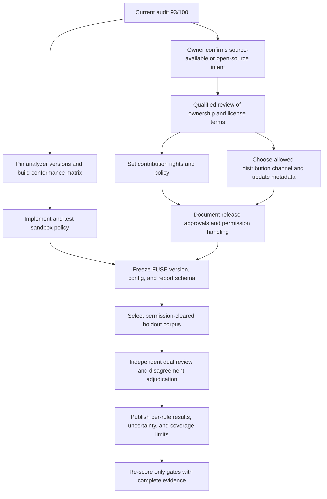

# FUSE maturity 100-point closure plan

**Research date:** 2026-11-02
**Current score:** 93/100
**Method:** Crawl4AI 0.9.5 browser retrieval of official NIST, Docker, Open Source Initiative, GitHub, Python Software Foundation, and Semgrep documentation.

## The remaining seven points

The current audit assigns the remaining points to four evidence gaps. A point is earned only after its stated evidence exists and the audit is updated. Adding a feature without verification does not close a point.

| Area | Current | Gap | Closure evidence |
| --- | ---: | ---: | --- |
| Code quality | 14/15 | Optional analyzer behavior is supported by bounded smoke runs, not a complete versioned conformance matrix | Pinned tool/version manifest; positive, clean, malformed, missing-tool, timeout, output-limit, and redaction controls; cross-platform job evidence and explicit partial/failure statuses |
| Security | 9/10 | Optional analyzer processes can access files and operating-system resources available to the FUSE user | Enforced sandbox policy, negative escape and network tests, resource-limit checks, supported-platform results, fail-closed behavior when isolation is required but unavailable, and updated threat model |
| Governance | 6/10 | Four licensing, contribution, distribution, and release-policy questions remain unresolved | Owner decision plus qualified legal review; matching license, contributor, and release policies; documented channel-specific permission and approval gates |
| Research rigor | 9/10 | Existing tests and NIST SARD results do not provide independent, representative field-accuracy adjudication | Frozen, permission-cleared holdout corpus; independent reviewers; disagreement adjudication; per-rule metrics with uncertainty and coverage limitations |

## The license decision comes first

FUSE's current license allows commercial use but restricts redistribution and publication of modifications. The Open Source Initiative definition requires free redistribution and permission to distribute derived works. GitHub's licensing guidance likewise says an open-source license must allow people to use, change, and distribute the software. These positions conflict. The current license is source-available, not OSI-approved open source.

There are two honest paths:

1. **Keep the no-redistribution intent.** Retain a source-available license, confirm its terms with qualified counsel, and describe the maturity dimension as project governance or source-available governance. Do not call the package open source. Do not publish a wheel, source archive, container, or PyPI package until channel-specific written permission and legal review are complete.
2. **Choose an open-source license.** Select an OSI-approved license with qualified guidance and accept the required rights to redistribute the source and modified versions. This changes the owner's stated no-copy restriction.

The owner should also confirm that the named copyright holder in `LICENSE` is the legal rights holder, decide whether outside code contributions are accepted, and set a contribution agreement or a clear no-public-contributions policy. An issue report and a code contribution grant different rights.

The current PyPI Terms of Service include ownership, right-to-post, and license-grant terms. The PyPI Acceptable Use Policy also prohibits infringing intellectual-property rights. These pages support reviewing the uploader's rights and package terms before publication. They do not determine whether this custom license is enforceable or suitable. The older PyPI Terms of Use URL redirects to a page marked superseded; use the current Terms of Service for any future review.

## Closure gates by score

### Code quality, 14 to 15

Build one analyzer conformance matrix for Syft, OSV-Scanner, Binwalk, and Gitleaks. Keep this gate separate from the security sandbox gate. It answers whether each adapter behaves predictably for the inputs and tool versions it claims to support.

1. Pin tool versions and immutable download digests in one checked-in manifest.
2. For each adapter, run an expected-positive control, a clean control, malformed or unsupported input, missing executable, timeout, output-limit, and secret-redaction case.
3. Assert normalized findings, exit status, coverage status, tool version, artifact digest, and that the selected input was not modified.
4. Run the supported matrix on the operating systems that FUSE claims to support. Unsupported combinations must report unavailable or partial, not clean.
5. Store schema-checked reports and update the integration documentation with the exact version and platform scope.

**Close the point when:** the pinned matrix passes in CI and each adapter's unsupported, failed, timed-out, and clean states are distinguishable in reports.

### Security, 9 to 10

Use defense in depth for external tools that parse user-selected projects, histories, SBOMs, or firmware. Docker documents rootless operation, a read-only root filesystem, capability drops, security options including `no-new-privileges`, a default seccomp profile, network selection, and CPU, memory, and PID constraints. These controls reduce exposure but do not prove a container is invulnerable or make all host/runtime combinations equivalent.

Proposed baseline for a supported sandbox mode:

- Prefer a rootless container runtime where available. Pin analyzer images by digest and do not run privileged containers or mount the container-runtime socket.
- Mount scan input read-only. Give the analyzer a dedicated temporary output directory and bounded scratch space. Keep the container root filesystem read-only.
- Drop all Linux capabilities, keep the default seccomp profile, set `no-new-privileges`, use a non-root container user, and avoid host PID, IPC, device, and network namespaces.
- Disable network access by default. If OSV online lookup is explicitly requested, make that a separate documented mode; prefer an offline database mounted read-only.
- Set memory, CPU, PID, wall-time, output-size, and temporary-storage limits. Terminate the container and its descendants when limits are exceeded.
- Report the selected isolation mode. If isolation is required but no supported runtime is available, fail closed or require a clearly named unsafe override. Never silently fall back to an unsandboxed invocation.
- Verify runtime behavior on every supported host. Linux rootless Docker guidance does not by itself establish the security behavior of Docker Desktop or another runtime on Windows and macOS.

Tests should cover the actual runtime command, read-only input, writable-output confinement, no-network behavior, resource-limit failures, timeout cleanup, missing runtime, and explicit unsafe opt-in. Update `docs/threat-model.md` and `docs/limitations.md` with both guarantees and residual risks.

**Close the point when:** the supported sandbox path is enforced by code, tested on its declared platforms, and unavailable isolation is visible and fail-closed according to policy. Merely documenting the Docker flags is not enough.

### Governance, 6 to 10

These are four separate one-point gates. They must follow the owner's licensing intent and qualified legal review.

| Gate | Decision and deliverable | Blocking dependency |
| --- | --- | --- |
| G1. Rights and license | Confirm rights holder, commercial and hosted use, private modification, redistribution, derivative works, reports, and trademark boundaries. Publish a counsel-reviewed license decision record. | Owner and qualified counsel |
| G2. Contributions | Decide whether outside code contributions are accepted. If yes, adopt counsel-reviewed contributor terms compatible with the license. If no, state that issues are welcome but public code patches require written permission. | G1 |
| G3. Distribution | Select source-only, GitHub Release assets, private distribution, or PyPI. Obtain written rights for that channel, review current registry terms, and make `pyproject.toml` metadata agree with the selected license. | G1 and current PyPI or host terms review |
| G4. Release and enforcement | Document who can approve a release or exception, how a user requests permission, how third-party notices are checked, and who receives license and security questions. Keep upload workflows disabled until G1 through G3 are complete. | G1, G2, and G3 |

**Close the four points when:** the selected path is written down, consistent across `LICENSE`, contribution guidance, package metadata, and release documentation, and reviewed by the qualified person identified by the owner. A GitHub Release or PyPI upload is not itself required if the chosen policy is source-only.

**Important ceiling:** if the owner keeps the no-redistribution restriction, the project remains source-available and cannot receive a truthful 10/10 under a criterion specifically named “Open Source Governance.” Either retain the 6/10 ceiling under that rubric or transparently rename the category and explain the changed rubric. Do not raise the score by changing labels without preserving comparability.

### Research rigor, 9 to 10

NIST SATE is a noncompetitive study of static-analysis effectiveness. Its process has tool makers analyze a shared program set and researchers review tool outputs; it is intended to support an evaluation methodology, not to declare a universal best tool. FUSE's 76/76 NIST SARD CWE-259 regression is useful known-case evidence, but it is one rule family and is not independent field accuracy.

Proposed independent evaluation:

1. Freeze the FUSE version, configuration, enabled rules, and report schema before selecting the holdout results.
2. Define the target population and inclusion rules for embedded projects, firmware, and hardware files. Check each source corpus license and permission before storing or publishing it.
3. Separate development cases from the holdout. Record repository commit IDs, file hashes, exclusions, unsupported inputs, and all skipped-file counts.
4. Have at least two reviewers independently label sampled findings as supported, unsupported, or uncertain, without seeing the other reviewer's label. Use an adjudicator for disagreements.
5. Sample some files or cases with no finding so the study can examine missed checks, not only emitted signals.
6. Publish per-rule precision and recall only where the labeling method supports those claims. Include confidence intervals, coverage, disagreement, applicability, and scope. Do not collapse unknown or partial input coverage into a clean result.
7. Keep the test manifest and review decisions reproducible while excluding secrets and proprietary source text from public reports.

8. Add a scope-aligned product comparison. Semgrep CE is a possible source-pattern baseline because its current language table lists community support for C and C++, limited to single-function analysis and community rules. Compare only rule categories where a pinned Semgrep rule set and FUSE check overlap. Gitleaks can be a separate secrets baseline. Pin both tool versions and rules, show which inputs and cases each tool covers, and report disagreements without turning different products into one overall ranking.
9. Have reviewers adjudicate disagreements between FUSE, the comparator, and the expected case labels. A second tool is a comparison point, not ground truth.

**Close the point when:** an independent review report, reproducible manifest, and scope-aligned product comparison are complete; limitations are recorded; and the evaluation protocol was not tuned against held-out results.

## Recommended flow

Order of work:

1. Owner and counsel settle the license path first. Sandbox and analyzer conformance engineering can proceed in parallel with this review.
2. Complete the analyzer conformance matrix, then implement the sandbox. Do not tune detectors against the future holdout.
3. Freeze the candidate and its report schema after CI passes across the declared platforms.
4. Select the licensed holdout and independent reviewers, run the protocol, adjudicate results, and publish the report.
5. Update the maturity table from the evidence. If the no-copy license remains, preserve the Open Source Governance ceiling unless the rubric is transparently revised.

## Crawl4AI sources

All pages below were fetched with Crawl4AI 0.9.5 on 2026-11-02. The NIST SATE, Docker, GitHub, OSI, Semgrep, and current Python Software Foundation policy pages returned HTTP 200. The legacy PyPI Terms of Use endpoint redirected to a page stating it was superseded, so this plan cites the current Terms of Service and Acceptable Use Policy instead.

- [NIST SATE overview](https://www.nist.gov/itl/csd/secure-systems-and-applications/samate/static-analysis-tool-exposition-sate)
- [Docker rootless mode](https://docs.docker.com/engine/security/rootless/)
- [Docker resource constraints](https://docs.docker.com/engine/containers/resource_constraints/)
- [Docker container run options](https://docs.docker.com/reference/cli/docker/container/run/)
- [Docker seccomp](https://docs.docker.com/engine/security/seccomp/)
- [Docker none network driver](https://docs.docker.com/engine/network/drivers/none/)
- [OSI Open Source Definition](https://opensource.org/osd)
- [GitHub repository licensing guidance](https://docs.github.com/en/repositories/managing-your-repositorys-settings-and-features/customizing-your-repository/licensing-a-repository)
- [PyPI Terms of Service](https://policies.python.org/pypi.org/Terms-of-Service/)
- [PyPI Acceptable Use Policy](https://policies.python.org/pypi.org/Acceptable-Use-Policy/)
- [Semgrep CE supported languages](https://docs.semgrep.dev/semgrep-ce-languages)

This is an engineering plan, not legal advice, a security certification, or a claim that a container eliminates analyzer risk.
