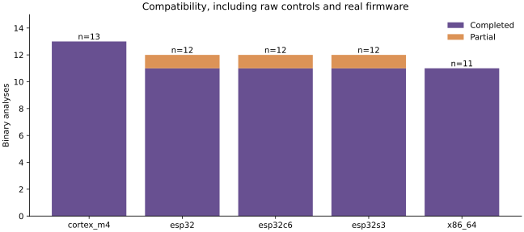
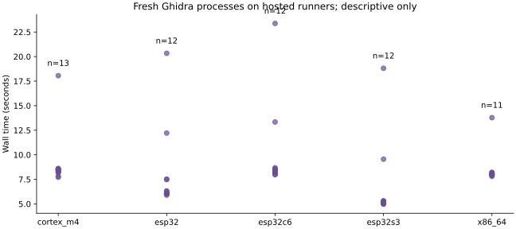

# FUSE embedded binary evaluation: 2026-11-14

A VIGIL Project

Controlled compatibility gates passed for five targets across four processor families. All three real ESP-IDF example ELFs produced **partial** results because bounded inventories were truncated. This establishes useful but incomplete real-firmware analysis, not full firmware coverage or security.

## Frozen configuration

The original [manifest](manifest.json) froze revision `2453884`. Run [43600357841](https://github.com/VIGIL-IoT/VIGIL-FUSE/actions/runs/43600357841) exposed URL credentials retained in Ghidra-generated label names. Commit `cca712e` fixes metadata sanitization only; native rule patterns and binary detection predicates are unchanged. The [replacement freeze](post-redaction/manifest.json) records that exception before independent sampling. No detector tuning was performed.

The successful run is [43600925661](https://github.com/VIGIL-IoT/VIGIL-FUSE/actions/runs/43600925661), harness revision `d84fe49`. Ghidra 12.2, Java 25, a 300-second adapter timeout, 128 MiB inputs, 8 MiB artifacts and 10 MiB diagnostics remain enforced. Exact Java patch, compiler versions, build flags, ELF hashes, language IDs, entry points, byte sizes and per-case timings are preserved in evidence/*/compatibility.json.

## Architecture compatibility

| Target | Completed | Partial | Total | Median seconds |
| --- | ---: | ---: | ---: | ---: |
| cortex_m4 | 13 | 0 | 13 | 8.43 |
| esp32 | 11 | 1 | 12 | 6.19 |
| esp32c6 | 11 | 1 | 12 | 8.36 |
| esp32s3 | 11 | 1 | 12 | 5.22 |
| x86_64 | 11 | 0 | 11 | 8.00 |

## Controlled binary accuracy

Construction labels mean a code-referenced plaintext endpoint should be reported, while HTTPS, MQTTS and retained unreferenced plaintext strings should not. They do not label exploitable vulnerabilities. ELF controls use O0/O1/O2/Os and stripped O2 variants. Identical binary hashes are deduplicated before metrics, but every compatibility run is retained. ARM raw controls are excluded from ELF accuracy.

| Target | Rule | TP | FP | TN | FN | n | Precision | Recall | F1 | 95% precision / recall interval |
| --- | --- | ---: | ---: | ---: | ---: | ---: | ---: | ---: | ---: | --- |
| cortex_m4 | FUSE-BIN-001 | 4 | 0 | 5 | 0 | 9 | 1.000 | 1.000 | 1.000 | [0.510, 1.000] |
| cortex_m4 | FUSE-BIN-002 | 4 | 0 | 5 | 0 | 9 | 1.000 | 1.000 | 1.000 | [0.510, 1.000] |
| esp32 | FUSE-BIN-001 | 4 | 0 | 5 | 0 | 9 | 1.000 | 1.000 | 1.000 | [0.510, 1.000] |
| esp32 | FUSE-BIN-002 | 4 | 0 | 5 | 0 | 9 | 1.000 | 1.000 | 1.000 | [0.510, 1.000] |
| esp32c6 | FUSE-BIN-001 | 4 | 0 | 5 | 0 | 9 | 1.000 | 1.000 | 1.000 | [0.510, 1.000] |
| esp32c6 | FUSE-BIN-002 | 4 | 0 | 5 | 0 | 9 | 1.000 | 1.000 | 1.000 | [0.510, 1.000] |
| esp32s3 | FUSE-BIN-001 | 4 | 0 | 5 | 0 | 9 | 1.000 | 1.000 | 1.000 | [0.510, 1.000] |
| esp32s3 | FUSE-BIN-002 | 4 | 0 | 5 | 0 | 9 | 1.000 | 1.000 | 1.000 | [0.510, 1.000] |
| x86_64 | FUSE-BIN-001 | 5 | 0 | 5 | 0 | 10 | 1.000 | 1.000 | 1.000 | [0.566, 1.000] |
| x86_64 | FUSE-BIN-002 | 5 | 0 | 5 | 0 | 10 | 1.000 | 1.000 | 1.000 | [0.566, 1.000] |

Intervals use the two-sided Wilson score method. They assume independent Bernoulli cases; compiler variants share source and are correlated. Treat these as descriptive case-count intervals, not calibrated population bounds. The small cohort cannot justify broad accuracy claims. Per-target macro participation, micro totals, exclusions and coverage are generated in metrics.json. No overall FUSE accuracy score is reported.

## Real embedded firmware corpus

The official ESP-IDF CC0-1.0 hello_world example was built for ESP32, ESP32-S3 and ESP32-C6 at commit `880a203ae603d08a94d06aa01e0d6761958e5e9e`, inside digest-pinned `espressif/idf@sha256:bf72fe7a15c22849a9a94147301165a545fb8905d97c176cf748e3e4614cac84`. ESP-IDF and linked components retain their individual licenses, including Apache-2.0 components. Only analysis reports are committed; third-party binaries are rebuilt by the workflow. These are real SDK example applications, not representative production products.

| Target | Language ID | Functions | Strings | Xrefs | Status | Truncated groups |
| --- | --- | ---: | ---: | ---: | --- | --- |
| esp32 | Xtensa:LE:32:default | 801 | 1024 | 585 | partial | exports, strings, symbols |
| esp32c6 | RISCV:LE:32:AndeStar_v5 | 924 | 1024 | 830 | partial | exports, strings, symbols |
| esp32s3 | Xtensa:LE:32:default | 981 | 1024 | 97 | partial | exports, strings, symbols |

## Coverage and safety

55 controlled ELFs completed; 2 Cortex-M raw controls completed with an explicitly declared Cortex language and linker origin 0x08000000. These flat raw fixtures have no vector table and do not establish generic raw firmware support. Three real ELFs were partial, never clean negatives. Schema checks, credential sentinel redaction and temporary-workspace cleanup passed the controlled gates. Per-case peak process-tree RSS is sampled every 50 ms; it is not a hard memory limit. Targets were never executed. No safety limits were increased to improve results.

## Native rules and public benchmarks

The existing [SARD catalogue](../../benchmark/sard-fuse001-cwe259-c-catalogue-results-2026-10-31.json) remains development-informed benchmark evidence. Mixed good/bad paths and SARIF file targets do not label every emitted literal or every negative file, so no native precision or recall was derived from it. Regression fixtures are explicitly separate from the controlled binary corpus and independent review material.

## Independent holdout and human review

[Selection](holdout-selection.json) was committed before fetching the pinned NetX Duo and TinyUSB source. [Reviewer packets](review/README.md) include pinned URLs, hashes, seven rule scopes, two unanswered independent forms and an empty adjudication form. Source text and machine observations are withheld from the packets. The selected snapshots were absent from earlier scan manifests, and sampled source hashes were checked against frozen regression hashes. The initial scan emitted no findings, so the packet currently supplies no-finding review cases only. A separately preregistered emitted-candidate supplement and two independent human reviewers are still required. Expected labels remain unknown. Reviewer count, agreement, disagreements and adjudications are all pending, not zero-quality outcomes. No independent field accuracy is established.

## Comparators and semantic prototype

No source scanner was presented as a comparator for Ghidra binary xrefs. A source comparison requires its own overlapping rule specification, pinned ruleset and human labels. It remains unmeasured. A P-code network-call argument prototype is deferred: bounded inventory truncation on real examples and the lack of independently labeled cross-architecture call-path controls make semantic claims premature. The current two binary rules establish code references only, not calls, reachability, taint analysis or exploitability.

## Performance

Exact input bytes, artifact bytes, function/string/xref counts, wall times, memory samples and inaccessible-process observations are recorded per case. Hosted timing differences are descriptive and not architecture speed rankings.

## Claim and evidence policy

| Supported claim | Evidence | Not established |
| --- | --- | --- |
| Controlled Cortex-M4, Xtensa and RV32 ELFs produce repeatable endpoint evidence | Per-case reports and successful workflow | All firmware for those platforms |
| Two binary rules match the frozen construction labels | Per-target confusion matrices | General vulnerability detection or field precision |
| Explicit flat Cortex-M raw fixtures can be analyzed | Two raw records | Automatic firmware mapping or architecture inference |
| Official ESP-IDF examples yield bounded metadata | Three partial real-project records | Complete real-firmware coverage |
| Independent review packets exist | Blank A/B/adjudication forms | Completed human review or independent accuracy |

## Reproduction

1. Dispatch `.github/workflows/embedded-ghidra-matrix.yml` using GitHub Actions. The workflow verifies frozen detector hashes, pinned Ghidra and Arm archive checksums, and the ESP-IDF image digest and source commit.
2. Download its five `embedded-evaluation-*` artifacts to a fresh local directory.
3. Run `python scripts/build_embedded_evaluation_report.py --source ARTIFACT_DIRECTORY --output reports/evaluation/2026-11-14`. Matplotlib is needed only for report figures.
4. Recalculate a target with `python scripts/evaluate_detection_accuracy.py reports/evaluation/2026-11-14/evidence/cortex_m4/dataset.json --output OUTPUT_DIRECTORY`.
5. Prepare review packets in a new directory with `python scripts/prepare_independent_review.py --selection reports/evaluation/2026-11-14/holdout-selection.json --work SOURCE_CACHE --output REVIEW_DIRECTORY`. GitHub CLI authentication and network access are required; no source builds or execution occur.

## Threats to validity and release decision

Known endpoints, one Cortex-M variant, one RV32 configuration, two closely related Xtensa chips, no hardware execution, no production-image diversity, small correlated controls and partial real-example inventories limit generalization. Optimization can remove evidence; xrefs need not imply network use. Default path exclusions can prevent key/test files from being scanned. No comparator study or human adjudication has completed. No maturity score was raised and no release was published for this experiment.

Primary references: [Ghidra headless interface](https://github.com/NationalSecurityAgency/ghidra/blob/Ghidra_12.2_build/Ghidra/RuntimeScripts/support/analyzeHeadlessREADME.md), [official Arm LLVM release](https://github.com/ARM-software/LLVM-embedded-toolchain-for-Arm/releases/tag/release-19.1.5), [pinned ESP-IDF toolchain definitions](https://github.com/espressif/esp-idf/tree/880a203ae603d08a94d06aa01e0d6761958e5e9e/tools/cmake), [official example](https://github.com/espressif/esp-idf/blob/880a203ae603d08a94d06aa01e0d6761958e5e9e/examples/get-started/hello_world/main/hello_world_main.c).
