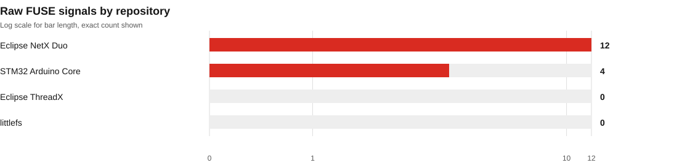
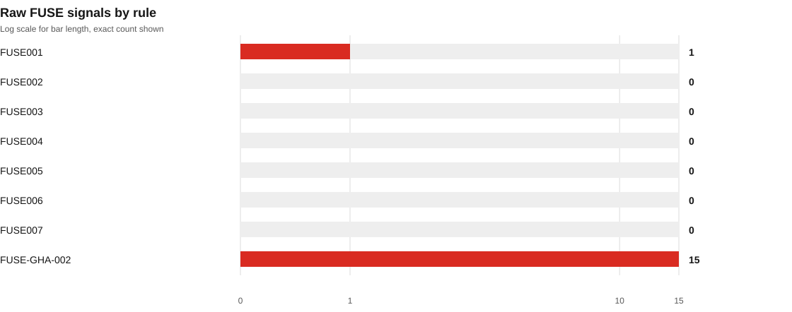
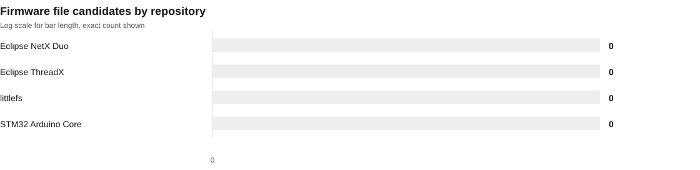
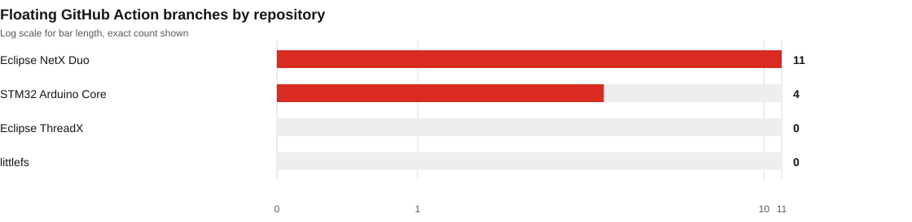
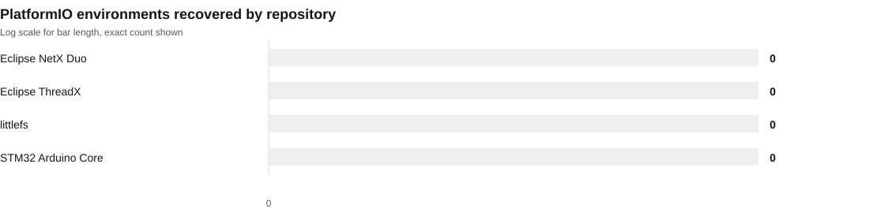
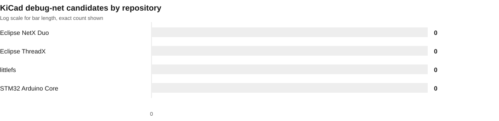

# FUSE independent validation

Scan date: 2026-10-28

## Purpose and limits

Qualitative scan of four independently selected, previously unscanned embedded and IoT repositories using the current FUSE build. Repositories were selected for architecture diversity before examining FUSE output. This is not a representative accuracy benchmark.

This uses a separately selected pinned repository corpus. It is a qualitative holdout, not a representative sample or accuracy benchmark. Every row is a static signal for review, not a confirmed vulnerability.

FUSE version `0.2.0` at commit `cc5fb46fe5cb`. The working source tree was dirty. Its recorded source hash is `54dcd7631772a0d0350ac7762e5386677a4b3aedf1a02870474f04ba585dea5e`.

## Run totals

| Measure | Result |
| --- | ---: |
| Repositories | 4 |
| Scan scopes | 4 |
| Files discovered | 17,610 |
| Files selected | 17,610 |
| Files scanned | 17,549 |
| Files skipped | 61 |
| Raw finding signals | 16 |

Severity and confidence are separate fields. Severity counts describe the possible impact suggested by a rule. Confidence describes the strength of the static match. Neither proves that the code is reachable or deployed.

Severity: 0 high, 1 medium, 15 informational. Critical: 0; low: 0.

### Signals by rule

| Rule | Count |
| --- | ---: |
| `FUSE001` | 1 |
| `FUSE002` | 0 |
| `FUSE003` | 0 |
| `FUSE004` | 0 |
| `FUSE005` | 0 |
| `FUSE006` | 0 |
| `FUSE007` | 0 |
| `FUSE-GHA-002` | 15 |

## Repository snapshots

Counts are raw per repository snapshot and are not deduplicated across repositories.

| Repository | Commit | Files scanned | Signals | High | Medium | Info | Status |
| --- | --- | ---: | ---: | ---: | ---: | ---: | --- |
| [Eclipse ThreadX](https://github.com/eclipse-threadx/threadx/tree/56c8695b1288fd4fac5406443c28878fade23872) | `56c8695b1288` | 3,844 | 0 | 0 | 0 | 0 | partial |
| [Eclipse NetX Duo](https://github.com/eclipse-threadx/netxduo/tree/ff27569d194f24d296452e1a884d3424f5bb39c9) | `ff27569d194f` | 3,529 | 12 | 0 | 1 | 11 | partial |
| [STM32 Arduino Core](https://github.com/stm32duino/Arduino_Core_STM32/tree/8bc8cc90b23975fb6722ef095780af16e6837f02) | `8bc8cc90b239` | 10,113 | 4 | 0 | 0 | 4 | partial |
| [littlefs](https://github.com/littlefs-project/littlefs/tree/6cb4e86540eca0d9ba62500a298385c9d863c8be) | `6cb4e86540ec` | 63 | 0 | 0 | 0 | 0 | completed |

## Report design notes

Screen question: what did FUSE surface in the pinned corpus, and how much of the selected input was actually covered? The main finding is the concentration of signals in credential-like example settings and explicit TLS bypass indicators.

The view uses the framed-sheet app style, seed `2054999557`, while keeping FUSE's red data accent and Schibsted type. Its signature element is a pinned-source ledger: each repository is tied to the exact commit, and each finding links to its file and line in that snapshot. The report-style time chart was replaced with repository and rule distributions because this run has no time-series data.

## Plots

## Additional inventory

- Firmware filename candidates: 0. Extensions: none. The scanner inventoried names and sizes only; it did not inspect firmware bytes.
- Hardware filename matches: 0. This is file inventory only. No schematic or PCB security analysis was performed, and no netlist components or nets were parsed.
- GitHub Actions: 24 workflow files and 61 non-SHA references inventoried, including 15 floating branch references. Non-SHA references include version tags and are not all unsafe.
- PlatformIO found 0 environments across 0 configuration files. No partial PlatformIO context was reported.

## Triage notes

FUSE001 retained 1 credential-like signal. This independent cohort has no placeholder-baseline comparison. Remaining matches are not automatically valid or deployed credentials. The published view omits matched evidence values.

FUSE002 produced 0 private-key marker signals. A marker match does not establish that key material is active, shipped, or trusted. Review intended use and packaging before changing rule behavior.

The current run includes 0 TLS verification-bypass signals. Review whether each matched call is reachable in a shipped configuration before interpreting severity as deployment risk.

## Noise reduction and triage

No placeholder-baseline comparison is attached to this cohort. The current run retains 1 FUSE001 signal for review. Placeholder filtering remains limited to fixture-backed patterns and does not suppress ordinary hard-coded values.

Manual source-context triage covers 16 current signals. See [`manual-triage.md`](manual-triage.md) and [`manual-triage.csv`](manual-triage.csv). The ledger excludes matched evidence values.

## Coverage caveats

- 3 of 4 scopes are marked partial. 61 selected files were skipped.
- 18 legacy text files used `iso-8859-1` fallback decoding: `system/Drivers/CMSIS/Device/ST/STM32F0xx/Include/stm32f0xx.h`, `system/Drivers/CMSIS/Device/ST/STM32G4xx/Include/stm32g4xx.h`, `system/Drivers/CMSIS/Device/ST/STM32H5xx/Include/stm32h5xx.h`, `system/Drivers/CMSIS/Device/ST/STM32MP1xx/Include/stm32mp1xx.h`, `system/Drivers/STM32F0xx_HAL_Driver/Src/stm32f0xx_hal_timebase_rtc_alarm_template.c`, `system/Drivers/STM32F0xx_HAL_Driver/Src/stm32f0xx_hal_timebase_rtc_wakeup_template.c`, `system/Drivers/STM32F1xx_HAL_Driver/Src/stm32f1xx_hal_timebase_rtc_alarm_template.c`, `system/Drivers/STM32F2xx_HAL_Driver/Src/stm32f2xx_hal_timebase_rtc_alarm_template.c`, `system/Drivers/STM32F2xx_HAL_Driver/Src/stm32f2xx_hal_timebase_rtc_wakeup_template.c`, `system/Drivers/STM32F3xx_HAL_Driver/Src/stm32f3xx_hal_timebase_rtc_alarm_template.c`, `system/Drivers/STM32F3xx_HAL_Driver/Src/stm32f3xx_hal_timebase_rtc_wakeup_template.c`, `system/Drivers/STM32F4xx_HAL_Driver/Src/stm32f4xx_hal_timebase_rtc_alarm_template.c`, `system/Drivers/STM32F4xx_HAL_Driver/Src/stm32f4xx_hal_timebase_rtc_wakeup_template.c`, `system/Drivers/STM32MP1xx_HAL_Driver/Inc/stm32mp1xx_hal_fdcan.h`, `system/Drivers/STM32MP1xx_HAL_Driver/Src/stm32mp1xx_hal_cryp.c`, `system/Drivers/STM32MP1xx_HAL_Driver/Src/stm32mp1xx_hal_cryp_ex.c`, `system/Drivers/STM32MP1xx_HAL_Driver/Src/stm32mp1xx_hal_wwdg.c`, `system/Middlewares/ST/STM32_USB_Host_Library/Class/HID/Src/usbh_hid_keybd.c`. This is disclosed coverage metadata.
- PlatformIO found 0 environments across 0 configuration files. No partial PlatformIO context was reported.
- GitHub Actions inventory found 24 workflow files and 61 non-SHA references. Non-SHA references include version tags and are not all unsafe.
- No build resolution, runtime or device validation, dependency advisory analysis, firmware byte inspection, or hardware design security review was performed.
- A clean scan means no enabled rule matched selected inputs. It does not prove that a project is secure or fully covered.

## Local artifacts

- `summary.json`: aggregate counts, coverage and provenance.
- `reports/<scope>/findings.json`: full versioned per-scope report with evidence.
- `reports/<scope>/findings.txt`: readable per-scope report.
- `reports/<scope>/findings.sarif`: SARIF per-scope report.
- `triage.csv`: source-linked finding index with evidence values excluded.
- `manifest.json`: pinned repository inputs and selection protocol.

The static site view is in `site/fresh-validation/`. The main site links to this report. No package release, deployment, or push is part of this local proof of concept.
