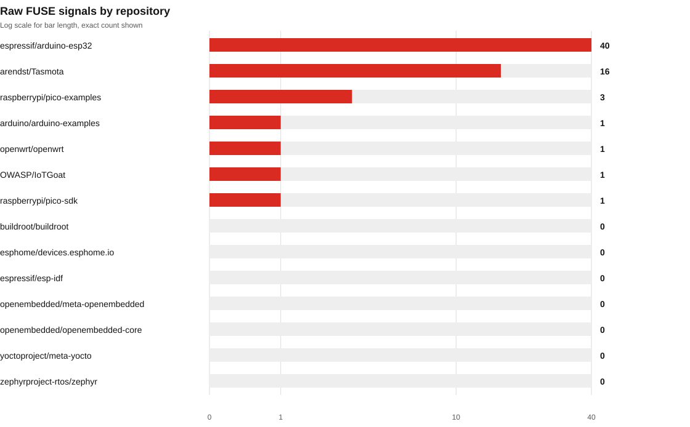
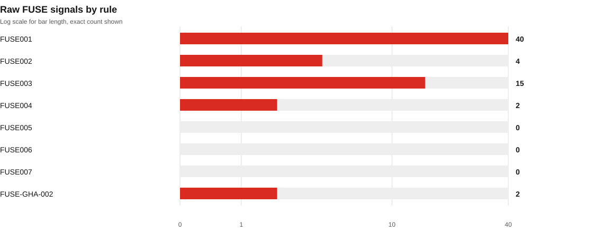
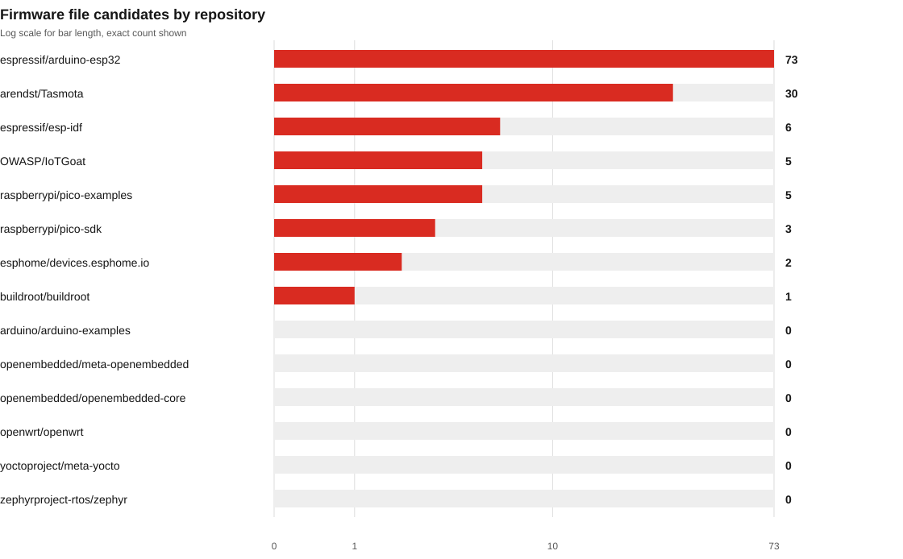
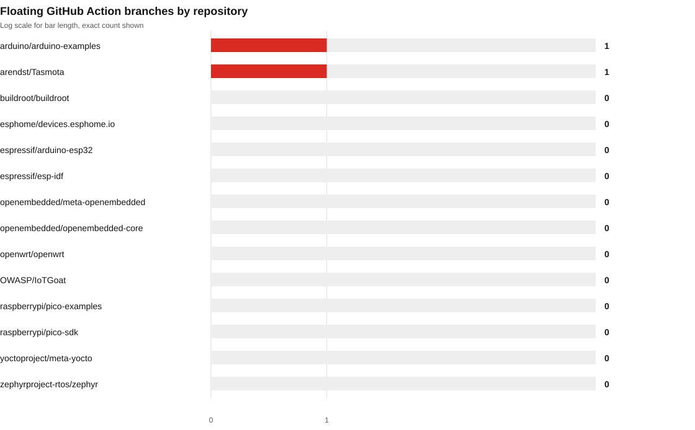
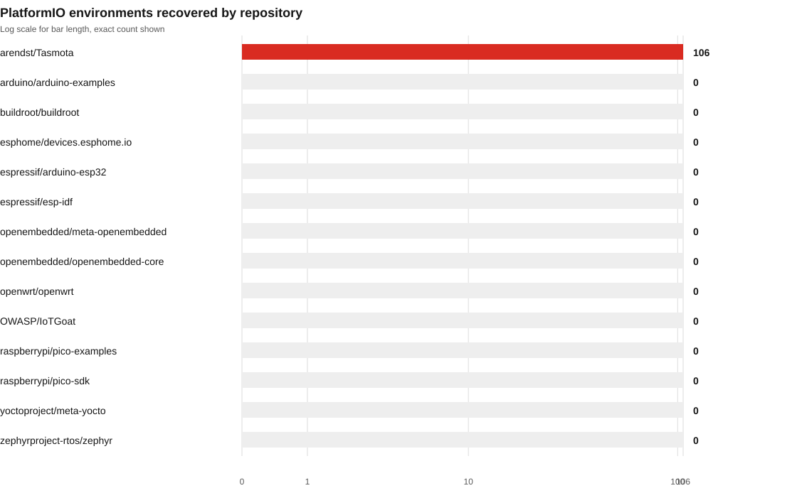

# FUSE regression validation

Scan date: 2026-10-28

## Purpose and limits

Rerun the existing pinned public-repository corpus after the local FUSE 0.2.0 schema 1.9 implementation changes.

This reruns a fixed, previously used public repository corpus after local FUSE changes. The corpus informed rule refinements, so this is regression validation. It is not an independent or blind holdout, a representative sample, or an accuracy benchmark. Every row is a static signal for review, not a confirmed vulnerability.

FUSE version `0.2.0` at commit `cc5fb46fe5cb`. The working source tree was dirty. Its recorded source hash is `63d4226166101bdea1000075c2cc01e1f6ae1230dd94bc6e5f276e6b907d854c`.

## Run totals

| Measure | Result |
| --- | ---: |
| Repositories | 14 |
| Scan scopes | 15 |
| Files discovered | 18,999 |
| Files selected | 18,859 |
| Files scanned | 18,855 |
| Files skipped | 4 |
| Raw finding signals | 63 |

Severity and confidence are separate fields. Severity counts describe the possible impact suggested by a rule. Confidence describes the strength of the static match. Neither proves that the code is reachable or deployed.

Severity: 19 high, 42 medium, 2 informational. Critical: 0; low: 0.

### Signals by rule

| Rule | Count |
| --- | ---: |
| `FUSE001` | 40 |
| `FUSE002` | 4 |
| `FUSE003` | 15 |
| `FUSE004` | 2 |
| `FUSE005` | 0 |
| `FUSE006` | 0 |
| `FUSE007` | 0 |
| `FUSE-GHA-002` | 2 |

## Repository snapshots

Counts are raw per scanned scope. The IoTGoat scope includes OpenWrt source also present in the OpenWrt snapshot, so some source lines overlap across repositories.

| Repository | Commit | Files scanned | Signals | High | Medium | Info | Status |
| --- | --- | ---: | ---: | ---: | ---: | ---: | --- |
| [OWASP/IoTGoat](https://github.com/OWASP/IoTGoat/tree/f67b7f961301d7a56b435fd7cffac73600f0c97b) | `f67b7f961301` | 1,651 | 1 | 0 | 1 | 0 | partial |
| [arendst/Tasmota](https://github.com/arendst/Tasmota/tree/63c38614ed0f19c550148d2d17f6e8cbaf8faea0) | `63c38614ed0f` | 6,800 | 16 | 10 | 5 | 1 | partial |
| [espressif/esp-idf](https://github.com/espressif/esp-idf/tree/d35ea023029363d97c42565f85e0db23486f26b2) | `d35ea0230293` | 77 | 0 | 0 | 0 | 0 | completed |
| [esphome/devices.esphome.io](https://github.com/esphome/devices.esphome.io/tree/232bac526f06237daabba9111cee7910ac282f9c) | `232bac526f06` | 73 | 0 | 0 | 0 | 0 | completed |
| [arduino/arduino-examples](https://github.com/arduino/arduino-examples/tree/50b66a3ce1e4e5e69cd96d3af5ca41a3383b311a) | `50b66a3ce1e4` | 92 | 1 | 0 | 0 | 1 | completed |
| [raspberrypi/pico-examples](https://github.com/raspberrypi/pico-examples/tree/0d62f75bafc2c8120d3276c3343d1a9195e909e9) | `0d62f75bafc2` | 373 | 3 | 3 | 0 | 0 | completed |
| [zephyrproject-rtos/zephyr](https://github.com/zephyrproject-rtos/zephyr/tree/c4aa9324508f6226bc6c491f114dbecaf9dffb36) | `c4aa9324508f` | 30 | 0 | 0 | 0 | 0 | completed |
| [openwrt/openwrt](https://github.com/openwrt/openwrt/tree/b5ff052caf4b7e90eb4b84941dec77bb5e4b5e08) | `b5ff052caf4b` | 368 | 1 | 0 | 1 | 0 | completed |
| [raspberrypi/pico-sdk](https://github.com/raspberrypi/pico-sdk/tree/079c6f39023649b154152db30f1d781e884879bc) | `079c6f390236` | 772 | 1 | 1 | 0 | 0 | completed |
| [espressif/arduino-esp32](https://github.com/espressif/arduino-esp32/tree/8e29d4de275cf58c767f453ff6ed26bea692dfec) | `8e29d4de275c` | 1,778 | 40 | 5 | 35 | 0 | completed |
| [buildroot/buildroot](https://github.com/buildroot/buildroot/tree/1cfdb4efd539ad5917bc43ac806a95687e7f4b6b) | `1cfdb4efd539` | 4,820 | 0 | 0 | 0 | 0 | partial |
| [openembedded/openembedded-core](https://github.com/openembedded/openembedded-core/tree/fa83da7da277a641c3a997d3da26041fa46d48ab) | `fa83da7da277` | 819 | 0 | 0 | 0 | 0 | completed |
| [openembedded/meta-openembedded](https://github.com/openembedded/meta-openembedded/tree/53276e6882048b990201b3c230e0b1fd0b8311b6) | `53276e688204` | 1,183 | 0 | 0 | 0 | 0 | completed |
| [yoctoproject/meta-yocto](https://github.com/yoctoproject/meta-yocto/tree/82013b83db7ba41da07694e201a7c43f561a9e00) | `82013b83db7b` | 19 | 0 | 0 | 0 | 0 | completed |

## Report design notes

Screen question: what did FUSE surface in the pinned corpus, and how much of the selected input was actually covered? The main finding is the concentration of signals in credential-like example settings and explicit TLS bypass indicators.

The view uses the framed-sheet app style, seed `2054999557`, while keeping FUSE's red data accent and Schibsted type. Its signature element is a pinned-source ledger: each repository is tied to the exact commit, and each finding links to its file and line in that snapshot. The report-style time chart was replaced with repository and rule distributions because this run has no time-series data.

## Plots

## Additional inventory

- Firmware filename candidates: 125. Extensions: .bin 99, .hex 20, .ota 5, .uf2 1. The scanner inventoried names and sizes only; it did not inspect firmware bytes.
- Hardware filename matches: 28. This is file inventory only. No schematic or PCB security analysis was performed, and no netlist components or nets were parsed.
- GitHub Actions: 23 workflow files and 88 non-SHA references inventoried. Two floating branch references produced informational findings. Non-SHA references include version tags and are not all unsafe.
- PlatformIO: 106 environments in 4 configuration files. One scope was partial.

## Triage notes

A spot check found a repeatable noise pattern in the Arduino-ESP32 results: all 35 FUSE001 credential-literal signals are under example directories, and the sampled lines use instructional placeholders. This confirms a rule-tuning opportunity. It does not classify every line as harmless, and the published view omits matched evidence values.

Four FUSE002 matches point to `private.pem` files in named example, encrypted-demo, or example-key paths in Raspberry Pi Pico repositories. Treat these as candidate demo/test keys until their purpose and usage are reviewed. Do not suppress solely by filename.

The report also contains repeated TLS verification bypass signals in sample and vendored code. Review whether the matched call is reachable in a shipped configuration before interpreting severity as deployment risk.

## Coverage caveats

- Three repository scopes are partial. Four selected files were skipped: two were not UTF-8 and two exceeded the scanner size limit.
- Tasmota PlatformIO configuration coverage is partial because referenced include files were unavailable in the pinned checkout.
- No build resolution, runtime or device validation, dependency advisory analysis, firmware byte inspection, or hardware design security review was performed.
- A clean scan means no enabled rule matched selected inputs. It does not prove that a project is secure or fully covered.

## Local artifacts

- `summary.json`: aggregate counts, coverage and provenance.
- `reports/<scope>/findings.json`: full versioned per-scope report with evidence.
- `reports/<scope>/findings.txt`: readable per-scope report.
- `reports/<scope>/findings.sarif`: SARIF per-scope report.
- `triage.csv`: source-linked finding index with evidence values excluded.
- `manifest.json`: pinned repository inputs and selection protocol.

The static site view is in `site/regression/`. The main site links to this separate regression page. No package release, deployment, or push is part of this local proof of concept.
