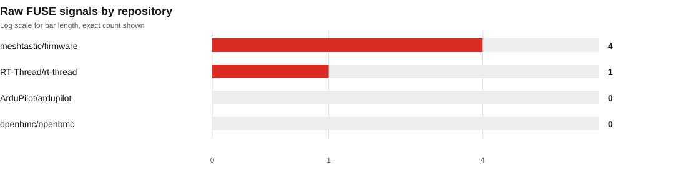
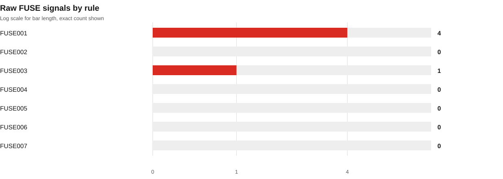
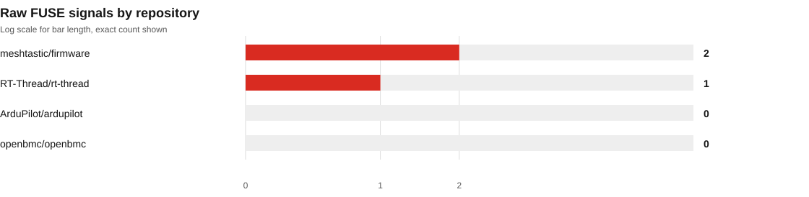

# Fresh transfer validation, 2026-10-31

This separate four-project cohort checks how FUSE's native rules and bounded inventories transfer to an autopilot, an RTOS, BMC recipes, and radio firmware. Repository commits and include scopes are pinned in [`manifest.json`](manifest.json). The initial reports were produced with FUSE 0.2.0 at `bbfcc69` before the credential-rule refinement. The later reports use FUSE 0.2.0 at `8bb65dd` and are classified as regression validation because this cohort informed the refinement.

This is a small purposive source-only sample. It is not representative, independently adjudicated, or an accuracy benchmark. Static findings do not prove active credentials, release inclusion, runtime reachability, deployed-product exposure, or exploitability. A repository with zero findings is not thereby secure.

## Results

The initial scan covered 4,347 files across 4 selected scopes and produced 5 raw signals. Source-context triage classified 3 as review-required candidates and 2 as false positives. After excluding credential-named filename and reserved-marker constants, the same pinned source scopes produced 3 raw signals. This is a comparison of observed matches in this cohort, not a precision or accuracy score.

| Snapshot | FUSE commit | Files scanned | Raw signals | Coverage notes |
| --- | --- | ---: | ---: | --- |
| Initial validation | `bbfcc69` | 4,347 | 5 | RT-Thread skipped one oversized source file. |
| Post-refinement regression | `8bb65dd` | 4,347 | 3 | RT-Thread remains partial. Meshtastic PlatformIO metadata remains partial because its include graph exceeded the configured path-match limit. |

The post-refinement summary records 22 PlatformIO environments detected, 0 explicitly selected, and 32 configuration files. FUSE did not invoke PlatformIO or build any project. The RT-Thread firmware filename inventory includes six `.bin` files located in lwIP fuzz-input directories. Their paths identify packet-test inputs, not firmware images. Filename-based candidates were not content-verified.

## Findings and coverage

See [`triage.md`](triage.md) for redacted source-context dispositions and limitations. Per-scope JSON, text, and SARIF reports are in [`scans/`](scans/). Post-refinement reports are in [`post-refinement/scans/`](post-refinement/scans/).

### Initial snapshot





### Post-refinement regression





Both scans were offline and source-only. Optional Syft, OSV-Scanner, Binwalk, and Gitleaks stages were explicitly disabled. No builds or project tests were run.

## Reproduce

Prepare sparse checkouts at the commits in the manifest, then run from the FUSE repository root:

```powershell
py scripts\run_repository_scan_pilot.py ..\fuse-scan-targets-fresh-validation-20261031 `
  --manifest reports\repository-scans\fresh-validation-20261031\manifest.json `
  --report-root reports\repository-scans\fresh-validation-20261031\scans

py scripts\build_holdout_scan_summary.py `
  --manifest reports\repository-scans\fresh-validation-20261031\manifest.json `
  --report-root reports\repository-scans\fresh-validation-20261031\scans `
  --output-root reports\repository-scans\fresh-validation-20261031

py scripts\run_repository_scan_pilot.py ..\fuse-scan-targets-fresh-validation-20261031 `
  --manifest reports\repository-scans\fresh-validation-20261031\post-refinement-manifest.json `
  --report-root reports\repository-scans\fresh-validation-20261031\post-refinement\scans

py scripts\build_holdout_scan_summary.py `
  --manifest reports\repository-scans\fresh-validation-20261031\post-refinement-manifest.json `
  --report-root reports\repository-scans\fresh-validation-20261031\post-refinement\scans `
  --output-root reports\repository-scans\fresh-validation-20261031\post-refinement
```

The initial and post-refinement manifests preserve separate FUSE provenance. The runner verifies clean checkouts at their pinned repository commits and disables optional network-capable analyzers.
