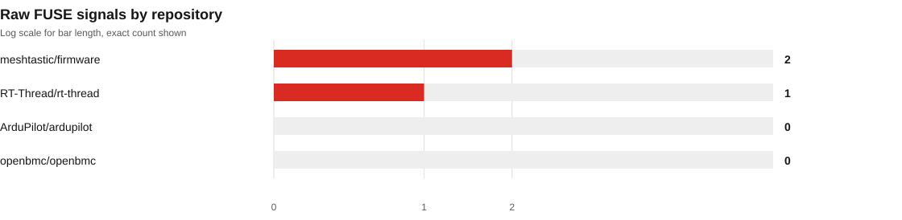

# FUSE 0.3.0 transfer replay, 12 November 2026

FUSE 0.3.0 scanned four pinned embedded and IoT repositories using the same selected scopes as the earlier FUSE 0.2.0 validation snapshot. This checks release behavior across an autopilot, an RTOS, embedded Linux recipes, and radio firmware. The full commits and selected paths are recorded in [`manifest.json`](manifest.json).

This is a purposive source-only regression replay. These repository families and scopes were previously reviewed, so this is not a blind holdout, representative sample, independent adjudication, or accuracy benchmark. Signals need project-specific review. A finding does not confirm a shipped-product weakness or exploitability.

## Results

| Measure | Result |
| --- | ---: |
| Pinned repositories and scopes | 4 |
| Files discovered | 4,360 |
| Files selected | 4,348 |
| Files scanned | 4,347 |
| Selected files skipped | 1 |
| Raw static findings | 3 |
| High severity findings | 1 |
| Medium severity findings | 2 |
| Partial scopes | 2 |

| Repository | Profile | Files scanned / selected | Findings | Status |
| --- | --- | ---: | ---: | --- |
| [ArduPilot/ardupilot](https://github.com/ArduPilot/ardupilot/tree/278a68a57aa0d9b98e6dbaaf9346f6b485f4c9ac) | `generic` | 260 / 260 | 0 | Complete |
| [RT-Thread/rt-thread](https://github.com/RT-Thread/rt-thread/tree/cbc19778d0ae5ef2533a28c0f62c6a399858010a) | `generic` | 2,126 / 2,127 | 1 | Partial, one selected file exceeded the scan size limit |
| [openbmc/openbmc](https://github.com/openbmc/openbmc/tree/c9bb07fa438f008aa1c998fe2e742a386cd15776) | `embedded-linux` | 230 / 230 | 0 | Complete |
| [meshtastic/firmware](https://github.com/meshtastic/firmware/tree/332b5b0a2c4fec2896de3c5fa63f46d5cd05ea98) | `generic` | 1,731 / 1,731 | 2 | Partial, PlatformIO extra-config and inheritance metadata did not fully resolve |

The RT-Thread skipped file makes that scope incomplete. Meshtastic's PlatformIO metadata report is partial because an `extra_configs` pattern exceeded the bounded match limit and some environment inheritance references were unresolved. The project was not built, and PlatformIO was not run.




See [`summary.json`](summary.json), [`triage.md`](triage.md), and each scope's JSON, text, and SARIF files in [`reports/`](reports/).

## Interpretation and limits

- All three findings were manually checked against the pinned source lines. They remain review candidates, not confirmed vulnerabilities. No false positive was established in this small review.
- The two `FUSE001` matches are non-empty password-like defaults. RT-Thread only applies its shell default inside its authentication feature path. Meshtastic copies its MQTT default into configuration state. Effective product configuration and deployment are unknown.
- The `FUSE003` match is a TLS verification bypass call inside Meshtastic's TLS-enabled branch. This is a meaningful source signal. Whether affected builds enable that path was not tested.
- A zero-signal result in ArduPilot or OpenBMC means only that no enabled rule matched the selected paths.
- FUSE ran offline. Syft, OSV-Scanner, Binwalk, Gitleaks, and Ghidra were not requested. No dependency advisory query, build, project test, firmware binary analysis, or physical device validation was performed.
- FUSE's native rules cover a narrow set of source and configuration patterns. This cohort cannot establish missed-vulnerability rates or overall product security.

## Reproduce

Use clean checkouts at the commits in the manifest. Install FUSE's development dependencies from the repository root, then run:

```powershell
py scripts\run_repository_scan_pilot.py ..\fuse-scan-targets-fresh-validation-20261031 `
  --manifest reports\repository-scans\release-0.3.0-transfer-2026-11-12\manifest.json `
  --report-root reports\repository-scans\release-0.3.0-transfer-2026-11-12\reports

py scripts\build_holdout_scan_summary.py `
  --manifest reports\repository-scans\release-0.3.0-transfer-2026-11-12\manifest.json `
  --report-root reports\repository-scans\release-0.3.0-transfer-2026-11-12\reports `
  --output-root reports\repository-scans\release-0.3.0-transfer-2026-11-12
```

The runner verifies clean pinned checkouts and FUSE source provenance. It disables network-capable and optional analyzers for this native-rule transfer check.
